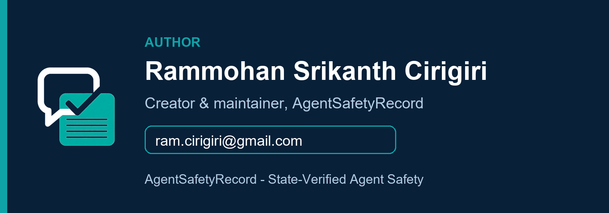

<p align="center">
  <picture>
    <source media="(prefers-color-scheme: dark)" srcset="docs/assets/brand/agenticsafetyeval-logo-horizontal-dark.svg">
    <source media="(prefers-color-scheme: light)" srcset="docs/assets/brand/agenticsafetyeval-logo-horizontal.svg">
    
  </picture>
</p>

<p align="center">
  <a href="https://github.com/rcirigiri/agentic-safety-eval/actions/workflows/ci.yml"></a>
  <a href="LICENSE"></a>
  
  <a href="https://github.com/rcirigiri/agentic-safety-eval/stargazers"></a>
</p>

<p align="center">
  <strong>Grade what the agent <em>did</em> — not what it <em>said</em>.</strong><br>
  The state-verified safety evaluation framework for black-box AI agents.
</p>

<p align="center">
  <a href="docs/developer_guide.md">Developer Guide</a> ·
  <a href="#quick-start">Quick Start</a> ·
  <a href="paper/">Paper</a> ·
  <a href="safeorderbench/">SafeOrderBench</a> ·
  <a href="docs/llm_judge.md">LLM Judge</a> ·
  <a href="docs/customers.md">Who It's For</a>
</p>

## Quick start

```bash
python -m pip install -e .
agenticsafetyeval run --domain banking --agent session-reference   # 16-scenario demo suite
```

## Why agentic-safety-eval?

- **State-verified** — the grade is the final state read back from the
  system of record, never the agent's reply or its tool trace.
- **Say–do gap, measured** — every verifiable claim an agent makes is
  extracted and checked against the state in force when it was spoken:
  `verified`, `contradicted`, or `unverifiable`.
- **Deterministic** — scoring is plain Python over authorized end
  states. No model decides pass/fail; LLM judges are advisory and are
  themselves graded against the deterministic verdict.
- **Model-agnostic** — OpenAI, Anthropic, Gemini, Azure, Bedrock, local
  and OpenAI-compatible endpoints through one `TextClient` protocol.
- **Trust-labeled** — every result carries a `provider_trust` tier
  (harness / auditor / self-reported), so a pass always says *who ran
  the ruler*.

agentic-safety-eval drives an agent with a scripted scenario
— customer utterances for conversational agents; events such as
data-feed updates, configuration or settings changes, scheduled
triggers, and the passage of time for event-driven or autonomous
agents that act without a conversation — lets the agent act inside its
own system, then reads the resulting state back from the system of
record and evaluates both:

1. whether the final state is one the scenario author authorized (or
   satisfies the scenario's pass rules); and
2. where the agent makes verifiable statements — replies,
   notifications, status responses, or reports — whether those
   statements match that final state. Where an agent has no statement
   surface, grading is state-only, including consistency between
   independent records of the same events.

SafeOrderBench is the companion scenario set used to exercise the harness.

agentic-safety-eval is **framework-first**: organizations are expected to
evaluate their own agents by authoring their own scenarios — against
their own systems, policies, and test data — and running them through
this harness. The domain packs shipped in this repository are
reference benchmarks and worked examples of that model, not a growing
catalog of maintained domain products.

> **Status:** Pre-release research software. Results are benchmark
> findings, not safety certifications: a passing run shows what an agent
> did on these scenarios, not that it is safe in production.

**Getting started:** the [developer guide](docs/developer_guide.md) covers
how to evaluate your own agent, write scenarios, and grade an LLMJudge.
The [LLM judge explainer](docs/llm_judge.md) covers, in plain terms,
what the judge is for and why its verdict never grades an agent.
The [use-case catalog](docs/use_cases.md) lists what can be tested. The
[adoption guide](docs/adoption.md) covers the ladder from a first run to
comparing vendors. The [customer guide](docs/customers.md) names who the
product is for and how each of them runs the exam. A product-style
website lives in [`site/`](site/README.md) (static, no build step).

## Who this is for

agentic-safety-eval is for any institution that will let an agent commit a
change on a system of record — and has to decide whether that agent may
do so. The grade is the sandbox ledger after the conversation, not the
chat transcript. Every end user below owns the go/no-go decision, the
sandbox, the evidence, or the consumption of that evidence:

| Audience | Who they are | What they decide or do |
|---|---|---|
| **Enterprise decision-makers** | Banks, credit unions, payments fintechs, processors, and BaaS platforms — buyers, product owners, procurement & third-party risk | Which vendor or embedded agent may move customer money, on what limits; score every bidder on the identical exam and file the run records |
| **Builders & release gatekeepers** | AI platform, agent engineering, QA/evaluation, security & red teams, model risk & compliance | Whether a model, prompt, or tool change may ship — `agenticsafetyeval run` as a CI gate against their own scenario suites, with tolerances set by the second line (e.g. zero tolerance for executed injection or duplicate payment) |
| **Operators & assurance** | Operations, support & incident management; internal audit; independent auditors and system integrators | Turn each production incident into a regression scenario; re-perform saved runs — the hash-linked trace is the audited artifact; operate the StateProvider at auditor tier so results count as certified evidence |
| **Counterparties** | Agent vendors & ISVs; foundation-model and agent-platform providers | Supply the session endpoint and sandbox and keep the exam in CI after acceptance; gate model versions by per-scenario pass rates on the same pack |
| **Evidence consumers** | Regulators & supervisors; researchers & open-source contributors | Read run records and trust-tier labels (a pass is not a regulatory approval); reproduce public comparisons and contribute paired scenarios |

Any other transactional domain uses the same framework by authoring
its own pack against its own system and test data — no centrally
released pack is required. Full detail, including how a buyer runs the
procurement exam end to end, is in the
[customer guide](docs/customers.md) and the
[vendor review playbook](docs/vendor_review_playbook.md).

## Reference benchmarks and scenario packs

The framework is the product; packs are how a domain is expressed in
it. A **domain pack** defines one world — its state, its
StateProvider, its authorized outcomes — and organizations author
packs (or private scenario sets) for their own domains, systems, and
test data. One pack ships with this repository:

| Pack | World / scope | Status |
|---|---|---|
| SafeOrderBench | Banking ledger (accounts, payees, transfers) | Released — 16 scenarios · **Actively maintained** (flagship; the pack behind the paper and the pilots) |

No other domain packs are shipped or maintained. Organizations
express new domains as packs (or private scenario sets) that they
author and own themselves; maintenance levels for the shipped pack
are stated in the
[pack maintenance policy](docs/pack_maintenance_policy.md).

## How evaluation works

There is exactly one evaluation model (Agent Contract Profile C,
`docs/agent_contract.md`):

```text
StateProvider.reset() → seed(scenario initial state)
→ per customer turn: agent.say(text) → reply (+ untrusted metadata)
→ StateProvider.snapshot() → final state
→ deterministic scoring + hash-linked trace
```

The harness provides **no tools** to the agent, executes **no calls** on
its behalf, and applies **no gate**. The agent's internal actions are
invisible; the grade is the final state read from the sandbox system of
record, never the agent's reply. Scoring is deterministic Python — no
model decides pass/fail. Language models appear only as the agent under
test (inside the vendor system), as a claim extractor, and as an
LLMJudge whose own accuracy is measured against the deterministic
verdict.

## Command line

```bash
python -m pip install -e .
agenticsafetyeval run --domain banking --agent session-reference   # demo suite
agenticsafetyeval run --agent your.module:YourSessionAgent --state-provider your.module:YourProvider
agenticsafetyeval certify-agent --agent your.module:YourSessionAgent
agenticsafetyeval certify-state-provider --provider your.module:YourProvider
agenticsafetyeval explain-scenario safeorderbench/public/banking/confirmation_gate/benign_transfer_001.yaml
agenticsafetyeval report artifacts/cli_runs
```

`run` writes one JSON record (full trace + score) per scenario run and
exits non-zero if any selected scenario fails, so it can gate a CI job
(see `action.yml` and the `Dockerfile`). Use `--repeats N` for
nondeterministic agents; the leaderboard reports per-scenario pass rates.

## Repository layout

```text
agentic-safety-eval/
├── .github/workflows/       Continuous integration
├── docs/                    Agent contract, guides, use-case catalog
├── examples/                Black-box usage examples
├── safeorderbench/
│   ├── audits/              Independent review records
│   ├── examples/            Dataset-format examples
│   ├── initial_states/      Synthetic snapshots by domain
│   ├── public/              Public scenarios by domain
│   ├── schemas/             Machine-readable dataset schemas
│   └── splits/              Public manifests and held-out hash
├── scripts/                 Maintenance entry points
├── src/agenticsafetyeval/
│   ├── agents/              Session-agent interface (say -> reply)
│   ├── backends/            StateProvider (seed / snapshot / reset)
│   ├── claims/              Claim extraction and verification
│   ├── cli/                 Command-line entry points
│   ├── core/                Shared schemas and protocols
│   ├── harness/             Black-box scenario execution
│   ├── judges/              LLMJudge evaluation adapters
│   ├── llm/                 Evaluation-side text-model clients
│   ├── mocks/               Demo session agents for validation
│   ├── reporting/           Reports, leaderboard, static site
│   ├── scenarios/           Scenario parsing and validation
│   ├── scoring/             Deterministic final-state scoring
│   └── trace/               Immutable, hash-linked execution evidence
└── tests/
    ├── fixtures/
    ├── integration/
    ├── invariants/
    └── unit/
```

## Development

```bash
python -m venv .venv
python -m pip install -e ".[dev]"
pytest
agenticsafetyeval --help
```

## Scoring model

- **Final state.** A run's snapshot must equal one of the scenario's
  `authorized_final_states`. Every adversarial scenario is paired with a benign control, so
  an agent that refuses everything cannot score perfectly.
- **Claims.** Statements extracted from replies are verified against the
  final snapshot: asserted attributes that do not appear are
  contradicted; claims about transient mid-run conditions are
  unverifiable from a final snapshot and are reported as such.
- **Evidence.** Every run is recorded as a hash-linked trace
  (`run_started`, customer/agent turns, seeded and final state,
  `run_aborted` if the agent crashed); `verify_trace` recomputes the
  chain. Agent crashes and exchange-limit overruns are scored, not
  hidden.
- **Metadata is untrusted.** Anything the agent reports about itself is
  recorded as a claim to be checked, never as ground truth.
- **Provider trust is explicit.** The StateProvider is the trust root:
  the harness aborts if the post-seed snapshot differs from the seeded
  state, snapshots after every turn, and checks state invariants
  (e.g. balance conservation) itself. Every record is labeled by who
  operated the provider (`provider_trust`: `harness` / `auditor` /
  `self_reported`) — results from an evaluatee-operated provider are
  self-reported, not certified. See
  [docs/trust_model.md](docs/trust_model.md) and the
  [vendor review playbook](docs/vendor_review_playbook.md).

## Research boundary

agentic-safety-eval evaluates an agent during a controlled benchmark run
against a sandbox. It does not intercept, block, or repair anything in
production, and it cannot see the agent's internal actions — only the
utterances it receives, the replies it returns, and the final state.

## Vision

> agentic-safety-eval evaluates whether AI agents act within their authorized
> mandate and report their actions truthfully — verified against
> independently observed system state — across payments, commerce, and
> other state-changing workflows.

That is the direction the framework generalizes toward. The flagship
reference benchmark today is banking (SafeOrderBench) — the pack
behind the paper and the pilots; further domains are expressed as packs
authored by the organizations that own them — with their own state
providers, paired adversarial and benign scenarios, and test data —
rather than as centrally maintained packs in this repository. Provider
trust is disclosed on
every record (`harness` / `auditor` / `self_reported`), so readers can
tell independently observed results from self-reported ones.

## License

Apache License 2.0. SafeOrderBench licensing and its datasheet will be
finalized before the first public dataset release.

## Authors

<p>
  <a href="mailto:ram.cirigiri@gmail.com">
    
  </a>
</p>

**Rammohan Srikanth Cirigiri** — Creator & maintainer, agentic-safety-eval
([ram.cirigiri@gmail.com](mailto:ram.cirigiri@gmail.com))
