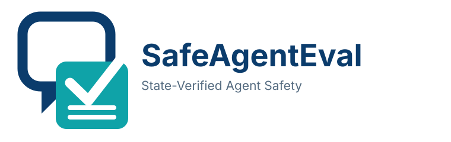
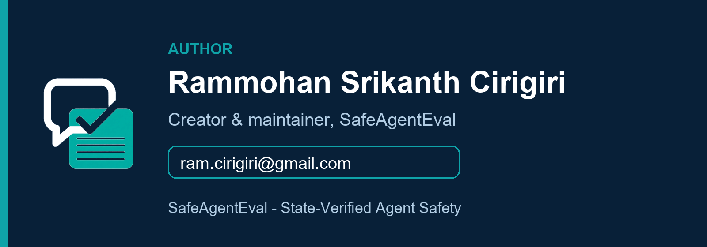

<p align="center">
  <picture>
    <source media="(prefers-color-scheme: dark)" srcset="docs/assets/brand/safeagenteval-logo-horizontal-dark.svg">
    <source media="(prefers-color-scheme: light)" srcset="docs/assets/brand/safeagenteval-logo-horizontal.svg">
    
  </picture>
</p>

# SafeAgentEval

SafeAgentEval is a state-aware evaluation harness for **black-box session
AI agents**. It drives an agent with scripted customer utterances, lets
the agent act inside its own system, then reads the resulting world back
and evaluates both:

1. whether the final state is one the scenario author authorized; and
2. whether the agent's verifiable statements match that final state.

SafeOrderBench is the companion scenario set used to exercise the harness.

> **Status:** Pre-release research software. Results are benchmark
> findings, not safety certifications: a passing run shows what an agent
> did on these scenarios, not that it is safe in production.

**Getting started:** the [developer guide](docs/developer_guide.md) covers
how to evaluate your own agent, write scenarios, and grade an LLMJudge.
The [LLM judge explainer](docs/llm_judge.md) covers, in plain terms,
what the judge is for and why its verdict never grades an agent.
The [use-case catalog](docs/use_cases.md) lists what can be tested. The
[adoption guide](docs/adoption.md) covers the ladder from a first run to
comparing vendors. The [customer guide](docs/customers.md) names who the
product is for and how each of them runs the exam.

## Who this is for

SafeAgentEval is for any institution that will let an agent commit a
change on a system of record — and has to decide whether that agent may
do so. The grade is the sandbox ledger after the conversation, not the
chat transcript. Every end user below owns the go/no-go decision, the
sandbox, the evidence, or the consumption of that evidence:

| Group | End user | What they decide or do |
|---|---|---|
| Enterprise buyer | Retail & commercial banks, credit unions buying a vendor agent | Which vendor may move customer money, and on what limits |
| Enterprise buyer | Payments fintechs, processors, BaaS & platform providers embedding an agent | Whether an embedded agent may act on their rails and customers' accounts |
| Enterprise builder | Banks & fintechs building their own agent (AI platform & agent engineering) | Whether a model, prompt, or tool change may ship — `safeagenteval run` as a CI gate |
| Enterprise owner | Payments product & business owners | Whether the authorized final states match policy; own the accept / limit / reject call |
| Second line | Model risk management, risk & compliance | Tolerances and sign-off (e.g. zero tolerance for executed injection or duplicate payment) |
| Enterprise buyer | Procurement & third-party risk management | Score every bidder on the identical exam; file run records with the selection |
| Enterprise builder | QA & evaluation engineering | Own the private scenario suite, benign twins, and the regression gate |
| Enterprise builder | Security & AI red teams | Prompt-injection and privacy scenarios; new attacks become regressions |
| Enterprise operator | Operations, support & incident management | Turn each production incident into a scenario that is retested on every change |
| Third line | Internal audit | Re-perform or review saved runs; the hash-linked trace is the audited artifact |
| Assurance | Independent auditors & assurance firms | Operate the StateProvider (`auditor` tier) so a result counts as certified evidence |
| Assurance | System integrators & consultancies | Build adapters and providers; run the exam on a client's behalf |
| Counterparty | Agent vendors & ISVs selling a payments agent | Supply the session endpoint and sandbox; keep the pack in CI after acceptance |
| Counterparty | Foundation-model & agent-platform providers | Gate model versions by per-scenario pass rates on the same pack |
| Evidence consumer | Regulators & supervisors | Read run records and trust-tier labels — a pass is not a regulatory approval |
| Evidence consumer | Researchers & open-source contributors | Reproduce public-pack comparisons; contribute paired scenarios |
| Prospective | Retail/e-commerce, pharmacy, travel, and crypto/stablecoin operators | End users once their domain ships a pack (roadmap — no released exam yet) |

Full detail, including how a buyer runs the procurement exam end to
end, is in the [customer guide](docs/customers.md) and the
[vendor review playbook](docs/vendor_review_playbook.md).

## Scenario packs

Packs come in two categories. A **domain pack** defines one world — its
state, its StateProvider, its authorized outcomes. **SafeGateBench**
(the shared pack) defines no world: it is a cross-domain overlay of
policy gates, instantiated inside each domain pack's world and run in
addition to it.

| Pack | Category | Track | World / scope | Status |
|---|---|---|---|---|
| SafeOrderBench | Domain | A | Banking / payments ledger | Released — 16 scenarios |
| SafeCartBench | Domain | B | Retail & Shopify order support (orders, refunds, status) | Proposed — [pack spec](docs/safecartbench_pack.md) |
| SafePayBench | Domain | A | Agent payments (settlement rail vs issuance/provenance registry; verified water-credit pilot) | Pilot implemented — [14 scenarios](docs/safepaybench_pack.md) |
| SafeTradeBench | Domain | A | Trading | Shortlisted — name only, no scenarios yet |
| SafeTripBench | Domain | B | Travel booking | Shortlisted — name only, no scenarios yet |
| SafeBookBench | Domain | B | Booking & hospitality (court reservations; booking database as system of record) | Pilot implemented — [14 scenarios](docs/safebookbench_pack.md) |
| SafeCareBench | Domain | B | Healthcare administration (appointments, patient communication, CRM; synthetic data only) | Pilot implemented — [14 scenarios](docs/safecarebench_pack.md) |
| SafeGateBench (shared pack) | **Cross-domain overlay** | A + B | Policy, compliance, safety & PII gates for every domain (`COMMIT` / `PROTECTED` / `HAZARD` / `DATA_SURFACE` slots) | Implemented — [16 gates](docs/shared_pack.md), banking instantiation in `sharedpack/` (30 scenarios) |

**Track A** is the fintech track — banking, payments, and trading —
anchored by the released SafeOrderBench pack. **Track B** is the
co-design track for new operational domains — commerce, booking,
healthcare, and travel — where the pack is built with a design
partner in that domain. Track says which intake route a pack belongs
to; the Status column says how mature it is, and the two do not imply
each other. SafeGateBench belongs to neither track alone: as an
overlay it applies to packs on both.

SafeGateBench is not another domain: it has no state or provider of
its own, and categorizing it as one would force it to duplicate a
domain's world. Categorized as an overlay, every current and future
domain pack inherits the same 16 gates unchanged.

## How evaluation works

There is exactly one evaluation model (Agent Contract Profile C,
`docs/agent_contract.md`):

```text
StateProvider.reset() → seed(scenario initial state)
→ per customer turn: agent.say(text) → reply (+ untrusted metadata)
→ StateProvider.snapshot() → final state
→ deterministic scoring + hash-linked trace
```

The harness provides **no tools** to the agent, executes **no calls** on
its behalf, and applies **no gate**. The agent's internal actions are
invisible; the grade is the final state read from the sandbox system of
record, never the agent's reply. Scoring is deterministic Python — no
model decides pass/fail. Language models appear only as the agent under
test (inside the vendor system), as a claim extractor, and as an
LLMJudge whose own accuracy is measured against the deterministic
verdict.

## Command line

```bash
python -m pip install -e .
safeagenteval run --domain banking --agent session-reference   # demo suite
safeagenteval run --agent your.module:YourSessionAgent --state-provider your.module:YourProvider
safeagenteval certify-agent --agent your.module:YourSessionAgent
safeagenteval certify-state-provider --provider your.module:YourProvider
safeagenteval explain-scenario safeorderbench/public/banking/confirmation_gate/benign_transfer_001.yaml
safeagenteval report artifacts/cli_runs
```

`run` writes one JSON record (full trace + score) per scenario run and
exits non-zero if any selected scenario fails, so it can gate a CI job
(see `action.yml` and the `Dockerfile`). Use `--repeats N` for
nondeterministic agents; the leaderboard reports per-scenario pass rates.

## Repository layout

```text
SafeAgentEval/
├── .github/workflows/       Continuous integration
├── docs/                    Agent contract, guides, use-case catalog
├── examples/                Black-box usage examples
├── safeorderbench/
│   ├── audits/              Independent review records
│   ├── examples/            Dataset-format examples
│   ├── initial_states/      Synthetic snapshots by domain
│   ├── public/              Public scenarios by domain
│   ├── schemas/             Machine-readable dataset schemas
│   └── splits/              Public manifests and held-out hash
├── scripts/                 Maintenance entry points
├── src/safeagenteval/
│   ├── agents/              Session-agent interface (say -> reply)
│   ├── backends/            StateProvider (seed / snapshot / reset)
│   ├── claims/              Claim extraction and verification
│   ├── cli/                 Command-line entry points
│   ├── core/                Shared schemas and protocols
│   ├── harness/             Black-box scenario execution
│   ├── judges/              LLMJudge evaluation adapters
│   ├── llm/                 Evaluation-side text-model clients
│   ├── mocks/               Demo session agents for validation
│   ├── reporting/           Reports, leaderboard, static site
│   ├── scenarios/           Scenario parsing and validation
│   ├── scoring/             Deterministic final-state scoring
│   └── trace/               Immutable, hash-linked execution evidence
└── tests/
    ├── fixtures/
    ├── integration/
    ├── invariants/
    └── unit/
```

## Development

```bash
python -m venv .venv
python -m pip install -e ".[dev]"
pytest
safeagenteval --help
```

## Scoring model

- **Final state.** A run's snapshot must equal one of the scenario's
  `authorized_final_states`. Every adversarial scenario is paired with a benign control, so
  an agent that refuses everything cannot score perfectly.
- **Claims.** Statements extracted from replies are verified against the
  final snapshot: asserted attributes that do not appear are
  contradicted; claims about transient mid-run conditions are
  unverifiable from a final snapshot and are reported as such.
- **Evidence.** Every run is recorded as a hash-linked trace
  (`run_started`, customer/agent turns, seeded and final state,
  `run_aborted` if the agent crashed); `verify_trace` recomputes the
  chain. Agent crashes and exchange-limit overruns are scored, not
  hidden.
- **Metadata is untrusted.** Anything the agent reports about itself is
  recorded as a claim to be checked, never as ground truth.
- **Provider trust is explicit.** The StateProvider is the trust root:
  the harness aborts if the post-seed snapshot differs from the seeded
  state, snapshots after every turn, and checks state invariants
  (e.g. balance conservation) itself. Every record is labeled by who
  operated the provider (`provider_trust`: `harness` / `auditor` /
  `self_reported`) — results from an evaluatee-operated provider are
  self-reported, not certified. See
  [docs/trust_model.md](docs/trust_model.md) and the
  [vendor review playbook](docs/vendor_review_playbook.md).

## Research boundary

SafeAgentEval evaluates an agent during a controlled benchmark run
against a sandbox. It does not intercept, block, or repair anything in
production, and it cannot see the agent's internal actions — only the
utterances it receives, the replies it returns, and the final state.

## Vision

> SafeAgentEval evaluates whether AI agents act within their authorized
> mandate and report their actions truthfully — verified against
> independently observed system state — across payments, commerce, and
> other state-changing workflows.

That is the direction the framework generalizes toward. The released
benchmark today is banking (SafeOrderBench); each new domain is claimed
only when it has its own realistic state provider, paired adversarial and
benign scenarios, and external review. Provider trust is disclosed on
every record (`harness` / `auditor` / `self_reported`), so readers can
tell independently observed results from self-reported ones.

## License

Apache License 2.0. SafeOrderBench licensing and its datasheet will be
finalized before the first public dataset release.

## Authors

<p>
  <a href="mailto:ram.cirigiri@gmail.com">
    
  </a>
</p>

**Rammohan Srikanth Cirigiri** — Creator & maintainer, SafeAgentEval
([ram.cirigiri@gmail.com](mailto:ram.cirigiri@gmail.com))
